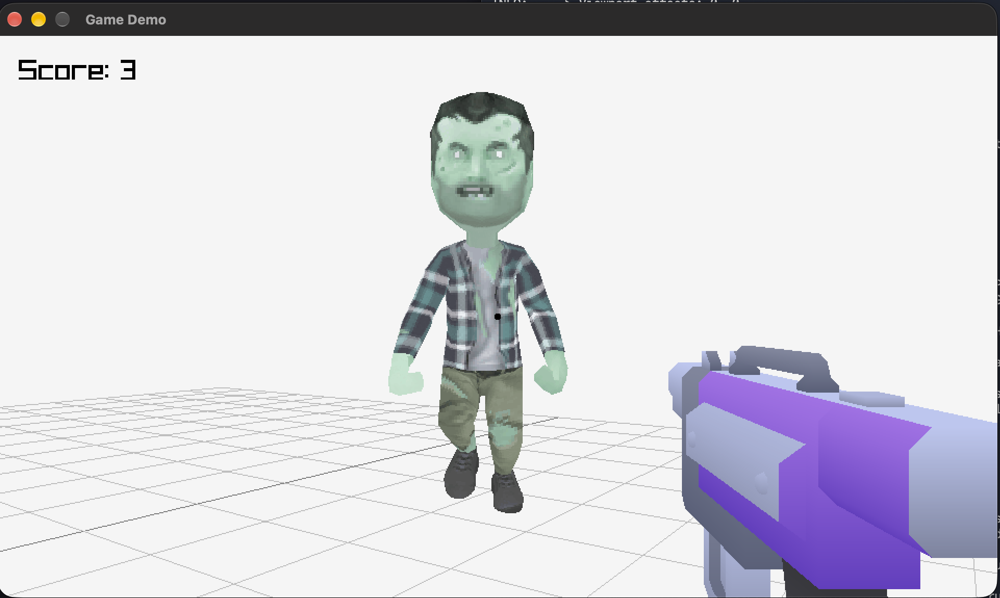
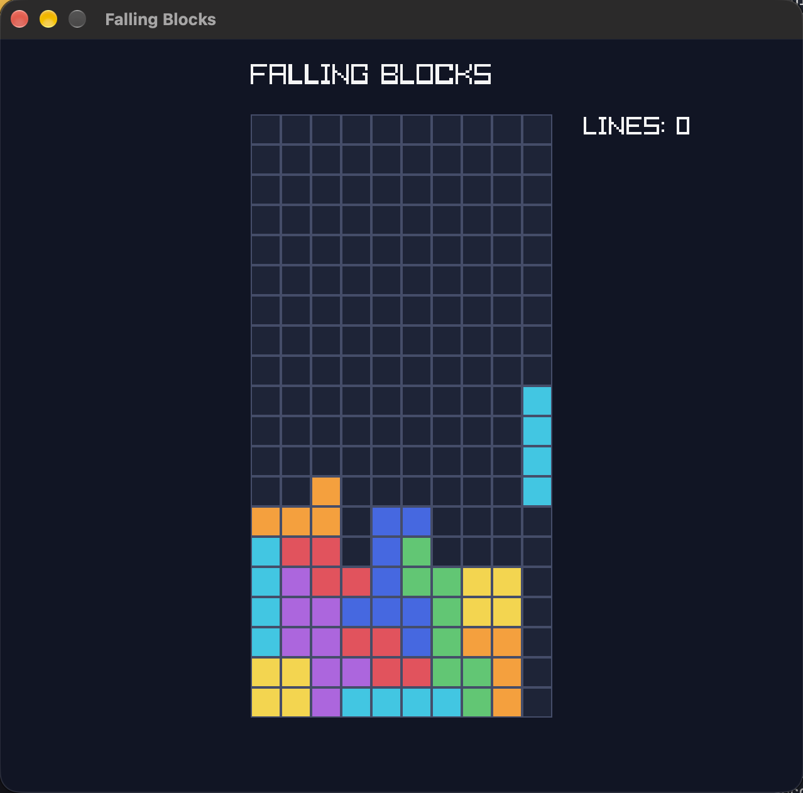

# Building a Programming Language in C++

A small programming language implemented in C++20 as a learning project.

This project is based on [msakuta/ruscal](https://github.com/msakuta/ruscal), the language introduced in the book [Rustで作るプログラミング言語](https://www.amazon.co.jp/dp/4297141922).

## Features

- Variables with explicit types: `f64`, `i64`, and `str`
- Arithmetic and comparison operators
- `if` / `else` statements
- `for` loops with `break` and `continue`
- User-defined functions and recursion
- Type checking
- Built-in functions

## Getting Started

### Requirements

- A C++20-compatible compiler
- CMake 3.24 or newer
- Ninja

From the repository root:

```bash
cmake -S . -B build -G Ninja -DBUILD_TESTING=OFF
cmake --build build
```

Pass your program as a single command-line argument:

```bash
./build/lang 'var x: f64 = 1 + 2; x;'
```

Expected output:

```text
result: Some(3)
```

### Example

```text
fn sum(limit: f64) -> f64 {
    var total: f64 = 0;

    for i in 0 to limit {
        total = total + i;
    }

    return total;
}

var result: f64 = sum(5);

if result > 0 {
    print("total:", result);
} else {
    print("zero");
}
```

## Tests

```bash
cmake -S . -B build/test -G Ninja -DBUILD_TESTING=ON
cmake --build build/test
ctest --test-dir build/test --output-on-failure
```

## Game Examples

The repository also includes two small games made with [raylib](https://www.raylib.com/):

- A 3D first-person shooter



- A falling-block puzzle game



See [examples/README.md](examples/README.md) for game descriptions, build instructions, and controls.

## References

- [*Rustで作るプログラミング言語*](https://www.amazon.co.jp/dp/4297141922)
- [Ruscal reference implementation](https://github.com/msakuta/ruscal)
