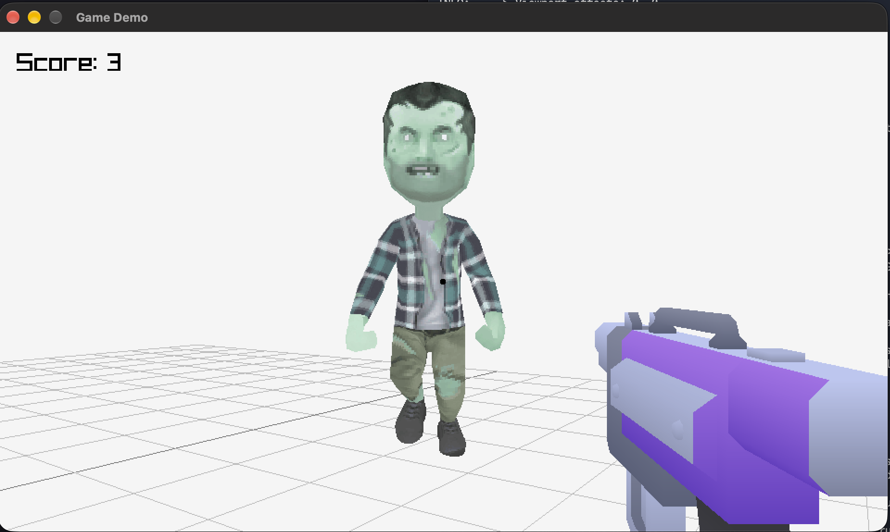
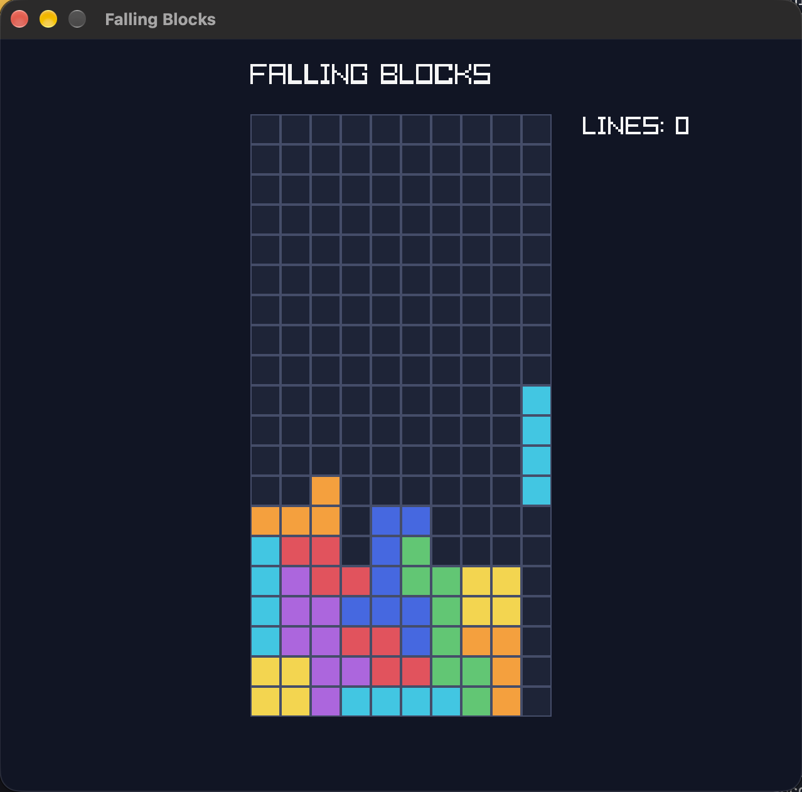

# Game Examples

Two small games built with the C++20 language implementation and [raylib](https://www.raylib.com).

## Build

### Requirements

- A C++20-compatible compiler
- CMake 3.24 or newer
- Ninja

Run the following commands from the repository root:

```bash
cmake -S . -B build/games -G Ninja \
  -DBUILD_TESTING=OFF \
  -DBUILD_FPS_DEMO=ON \
  -DBUILD_BLOCK_DEMO=ON
cmake --build build/games
```

This builds two executables: `fps-demo` and `block-demo`.

## 3D FPS

A small first-person shooter featuring player movement, aiming, shooting, and an enemy.



### Run

```bash
./build/games/fps-demo "$(cat examples/fps_demo/game.lang)"
```

| Action | Control |
| --- | --- |
| Move | W / A / S / D |
| Look around | Mouse |
| Shoot | Left mouse button |
| Exit | Esc |

### License

The included 3D assets are from [Kenney](https://kenney.nl). See [Third-Party Assets](fps_demo/assets/THIRD_PARTY_ASSETS.md) for credits and license details.

## Falling-Block Puzzle

A 10 × 20 falling-block puzzle game. Move and rotate pieces, complete rows, and clear lines.



### Run

```bash
./build/games/block-demo "$(cat examples/block_demo/game.lang)"
```

| Action | Control |
| --- | --- |
| Move left / right | Left / Right arrow |
| Rotate | Up arrow |
| Hard drop | Down arrow |
| Exit | Esc |

